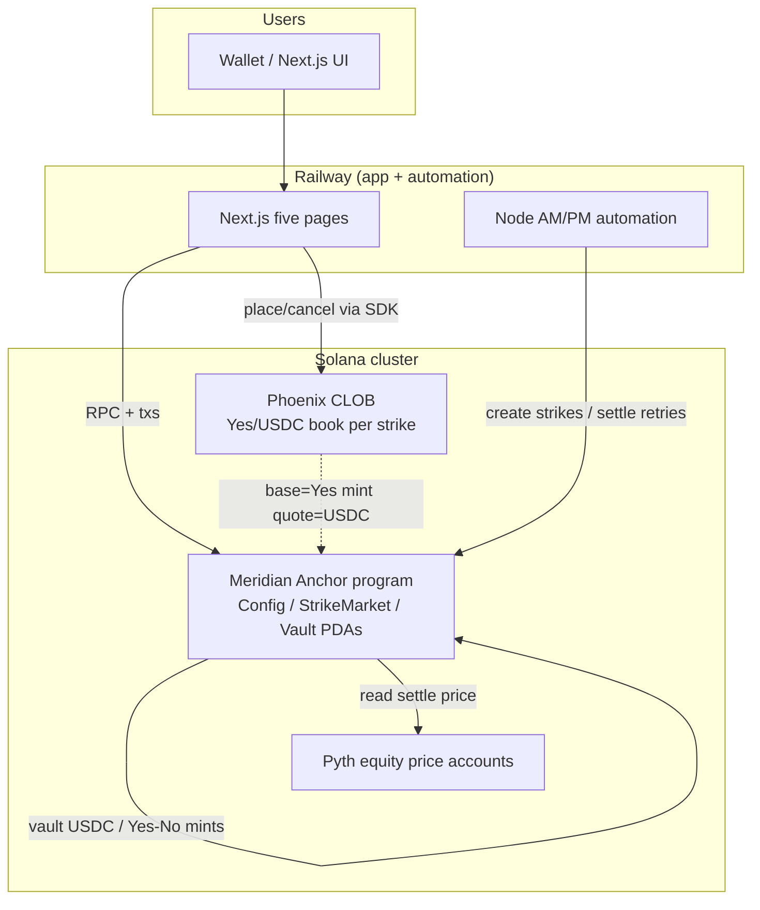

# Meridian architecture (V1)

Companion detail: [`SCHEMA.md`](SCHEMA.md) · [`flows.md`](flows.md) · [`DEPLOY.md`](DEPLOY.md) · [`sim-clock.md`](sim-clock.md)

## Component diagram

## Trust boundaries

| Boundary | Trust assumption |
| --- | --- |
| User wallet → Meridian ixs | User signs mint/redeem/trade; program enforces vault math |
| Admin / authority | Pause, config (capped/timelocked in prod), delayed `admin_settle` only — **no** prod vault drain |
| Phoenix | External matcher; Meridian stores market pubkey + mint wiring; does not match |
| Pyth | External oracle; program enforces staleness + conf gates then freezes outcome |
| Railway | Hosts UI + automation only; **never** embeds `localnet-test` fixtures; keys via secrets |
| Localnet fixtures | `sim_*`, mock Pyth, `test_drain_vault` — compile **only** with `localnet-test` |

## Data / control flow (happy path)

1. Automation or admin **creates** strike market (expiry, strike e6, Phoenix market, Pyth account).
2. User **mints** Yes/No against USDC into vault PDA.
3. User **trades** on Phoenix Yes/USDC book (four intents mapped in UI).
4. After session close / ≥4:00 PM ET (prod) or `sim_close` (localnet): **settle** from Pyth → immutable Yes/No/Void.
5. Winner **redeems** 1:1 USDC (fee policy per SCHEMA); loser burns worthless.

Sim path (D-017): same lifecycle under `localnet-test` with simulated open/close and forced outcomes — prod gates unchanged. Sequence detail: [`flows.md`](flows.md).
