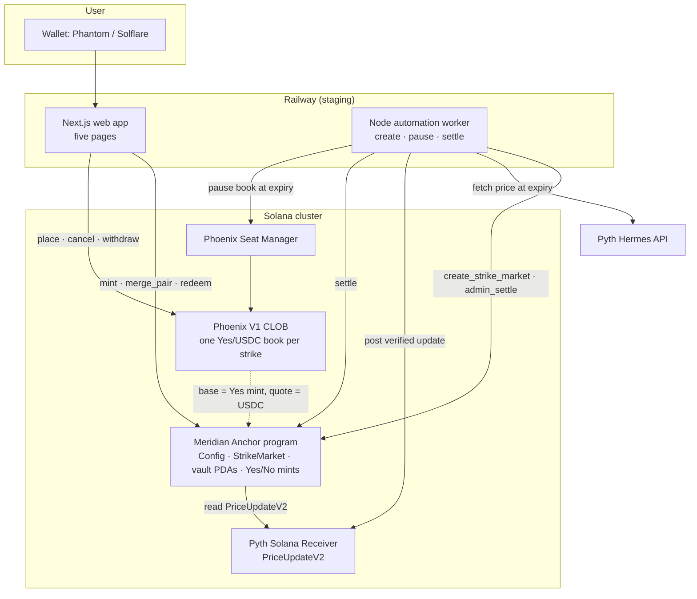
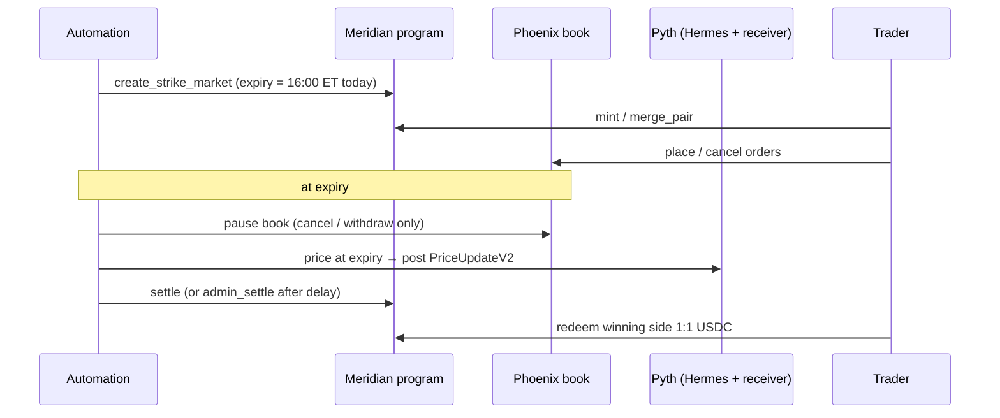

# Meridian architecture (V1)

Companions: [`SCHEMA.md`](SCHEMA.md) (accounts, instructions, events, invariants) · [`flows.md`](flows.md) (sequence diagrams) · [`units.md`](units.md) · [`sim-clock.md`](sim-clock.md) · [`DEPLOY.md`](DEPLOY.md)

## 1. Components

| Component | Code | Job |
| --- | --- | --- |
| Program | `programs/meridian` | Holds collateral in a PDA vault; mints Yes+No pairs at $1; merges pairs back; settles from Pyth; redeems winners 1:1 |
| Web app | `apps/web` | Markets, Trade, Portfolio, History, Landing. Maps four intents (Buy/Sell Yes/No) onto the single Yes/USDC book |
| Automation | `apps/automation` | Creates the day's MAG7 markets, pauses books at expiry, settles (pull oracle, else `admin_settle`) |
| Operator scripts | `ops/` | Devnet bootstrap, operator prices, settle checks, pause watcher backstop |
| Phoenix | external | Matching. Meridian never matches orders (D-002 / D-015) |
| Pyth | external | Settlement price via the pull oracle (D-025) |

## 2. How the four intents map onto one book (D-004, D-018)

| Intent | What the client sends |
| --- | --- |
| Buy Yes | Phoenix bid on Yes/USDC |
| Sell Yes | Phoenix ask |
| Buy No | Meridian `mint` (Yes+No) + Phoenix ask of the Yes at `1 − p_no`, one transaction |
| Sell No | Phoenix bid of Yes at `1 − p_no` + Meridian `merge_pair` (Yes+No → USDC), one transaction for market orders |

Market orders are fill-or-kill at the worst price (D-024): a Buy No that cannot fully fill reverts the mint too.

## 3. Daily lifecycle

The worker creates the day's markets from 07:00 ET, by 08:00 ET, with strikes ATM on the previous session's close (D-026). Details: [`DEPLOY.md`](DEPLOY.md) §6.

## 4. Trust boundaries

| Boundary | Assumption |
| --- | --- |
| User wallet → program | The user signs mint / merge / redeem / trades. The program enforces vault math; it trusts no client value |
| Config authority | Pause, capped and time-locked config changes, delayed `admin_settle` (outcome must match `price ≥ strike`, D-018 Policy A). No vault drain in prod builds |
| Settler | Any signer can call `settle`; the price account decides. A separate low-balance key pays for it |
| Pauser | Full Seat Manager authority over the books (not pause-only). Hot key today; a program PDA replaces it before mainnet ([`design/phoenix-pause-pda-authority.md`](design/phoenix-pause-pda-authority.md)) |
| Phoenix | External matcher. Meridian stores the book pubkey and mint wiring only |
| Pyth | Prod `settle` accepts only a receiver-owned, Full-verified `PriceUpdateV2` with the market's feed id, the first update at or after expiry, within 60 s, conf ≤ 500 bps (D-025, D-005) |
| Railway | Hosts web and automation only. Never holds the upgrade key or `localnet-test` builds |
| Localnet fixtures | `sim_*`, SimClock, mock Pyth, `test_drain_vault` compile only with `localnet-test`; CI asserts they are absent from the prod `.so` and IDL |

## 5. Anytime sim (D-017)

Locally the same lifecycle runs on demand: the SimClock PDA (or `sim_open_session` / `sim_close_session`) moves the effective clock, mock Pyth supplies a forced price, and settle / redeem follow. Prod gates are unchanged and the sim code is not in prod builds. See [`sim-clock.md`](sim-clock.md) and [`DEPLOY.md`](DEPLOY.md) §3.

## 6. Where the diagrams are

| Diagram | Location |
| --- | --- |
| Components, intents, daily lifecycle | This file |
| Mint / merge / trade / settle / redeem / pause sequences | [`flows.md`](flows.md) |
| UI routes | [`ui/07-ia-and-routes.md`](ui/07-ia-and-routes.md) |
| Wireframes | [`ui/wireframes/`](ui/wireframes/README.md) |
| SimClock / `effective_clock` | [`sim-clock.md`](sim-clock.md) |
