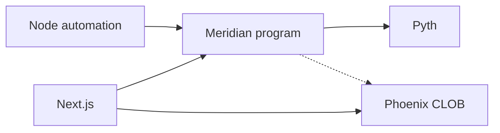

# Meridian diagrams index

Central index of mermaid / flow visuals. Prefer editing source docs over duplicating diagrams here.

| Diagram | Location | Purpose |
| --- | --- | --- |
| Mint / trade / settle / redeem sequences | [`flows.md`](flows.md) | On-chain + Phoenix happy paths |
| Component + trust boundaries | [`ARCHITECTURE.md`](ARCHITECTURE.md) | Program, Phoenix, Pyth, Next.js, Railway |
| UI IA / routes | [`ui/07-ia-and-routes.md`](ui/07-ia-and-routes.md) | Five-page map |
| SimClock / effective_clock | [`sim-clock.md`](sim-clock.md) | Localnet time gates (D-017) |
| Deploy ladder (table) | [`DEPLOY.md`](DEPLOY.md) | Localnet → Railway prod |

## Quick architecture (see ARCHITECTURE for full)

When adding a new diagram, link it from this index and from TRACKER if it is a deliverable.
