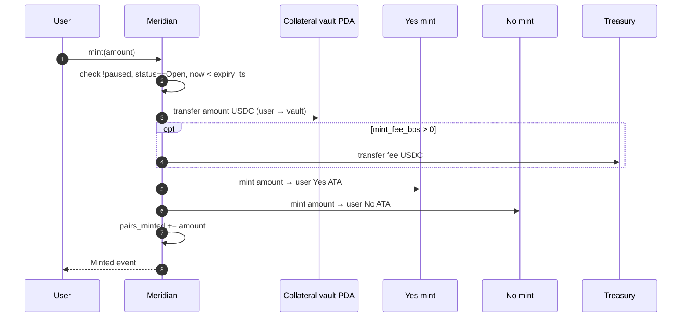
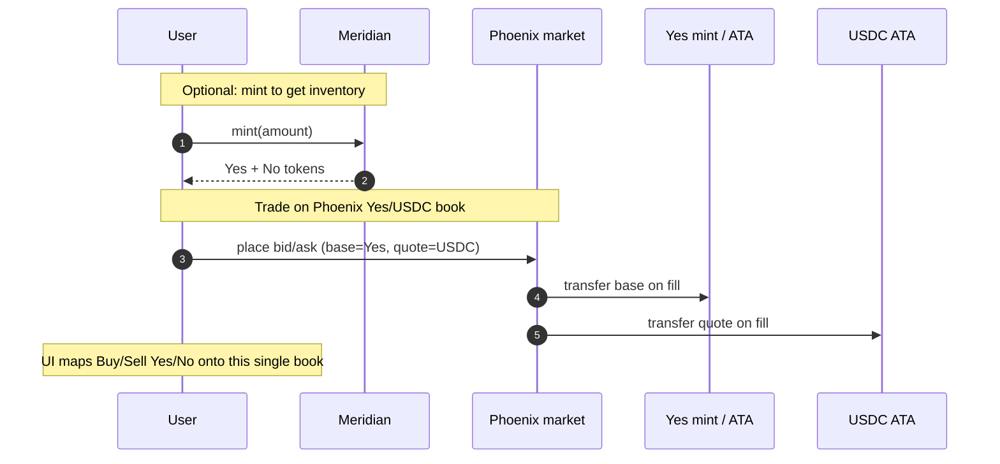
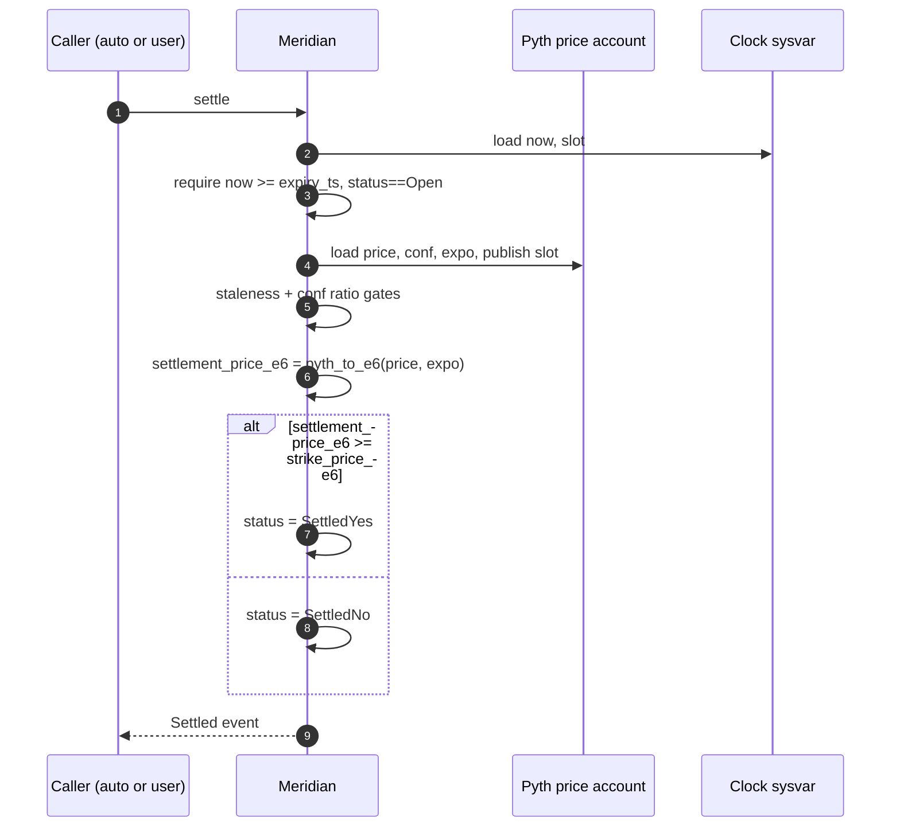
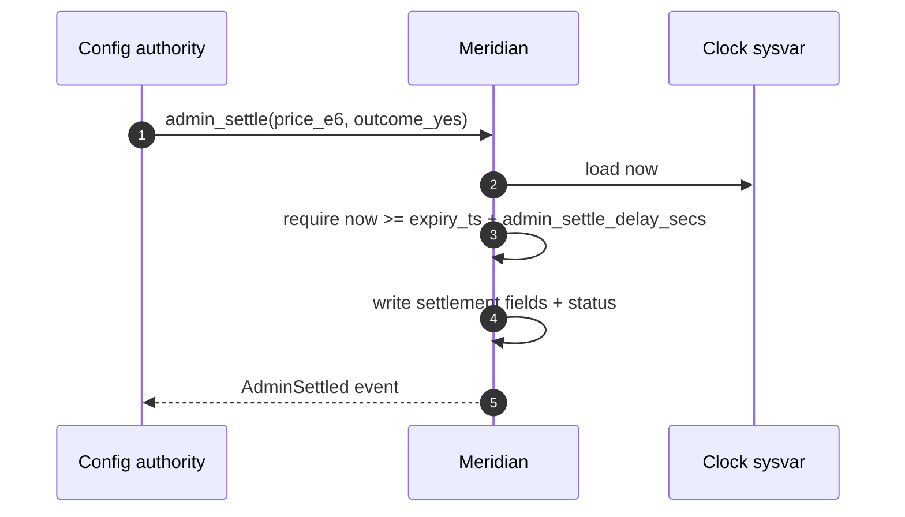
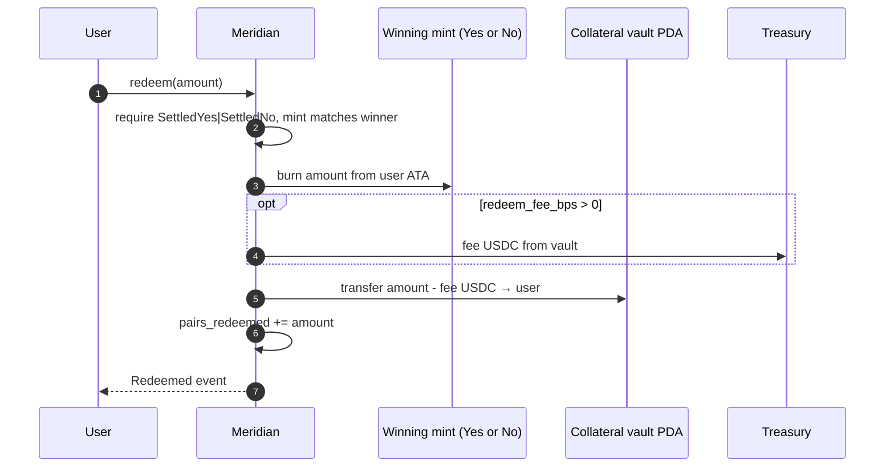
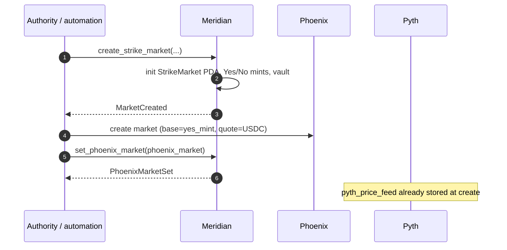
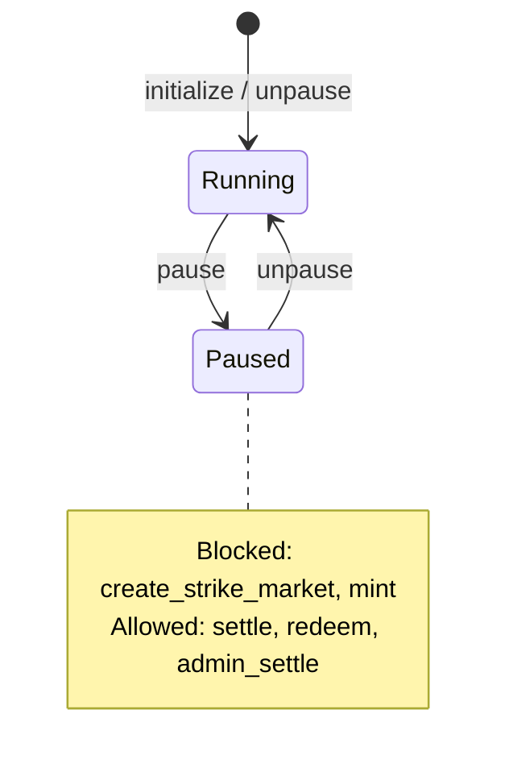

# Meridian Instruction Flows

Sequence diagrams for mint, Phoenix trading (beside Meridian), settle, and redeem. Account lists and state machines match [`SCHEMA.md`](SCHEMA.md).

---

## 1. Daily lifecycle (product)

```mermaid
sequenceDiagram
    autonumber
    participant Auto as Automation (TS)
    participant Mer as Meridian program
    participant Phx as Phoenix CLOB
    participant Pyth as Pyth
    participant User as User

    Note over Auto,Mer: ~08:00 ET — compute strikes from prior close
    Auto->>Mer: create_strike_market (per strike)
    Auto->>Phx: create/configure market (base=Yes, quote=USDC)
    Auto->>Mer: set_phoenix_market (if not set at create)

    Note over User,Phx: 09:30–16:00 ET — mint + trade
    User->>Mer: mint(amount)
    User->>Phx: place/cancel/fill Yes↔USDC

    Note over Auto,Pyth: ~16:05 ET — settle
    Auto->>Pyth: read equity close
    Auto->>Mer: settle (permissionless; retries)
    User->>Mer: redeem(winning amount)
```

---

## 2. Mint Yes/No against collateral

Users lock USDC and receive equal Yes and No SPL tokens. Trading happens afterward on Phoenix (not inside this ix).



**State transition:** `pairs_minted` increases; `status` unchanged (`Open`).

**Invariant:** `yes.supply == no.supply`; vault balance covers outstanding pairs.

---

## 3. Phoenix beside mint (trade path)

Meridian does not match orders. After mint (or after buying Yes on Phoenix), the user interacts with Phoenix directly.



**Wiring stored on `StrikeMarket`:**

- `phoenix_market`
- `phoenix_base_mint == yes_mint`
- `phoenix_quote_mint == collateral_mint`

**No Meridian CPI required for trades.** Indexers join fills via Phoenix + `MarketCreated` / `PhoenixMarketSet` events.

---

## 4. Settle via Pyth

Permissionless after `expiry_ts`. Automation retries per PRD (~15m window / 30s interval); anyone may call when Pyth is fresh enough.



**State transition:** `Open` → `SettledYes` | `SettledNo`. Vault unchanged at settle.

### Admin settle (delayed override)



---

## 5. Redeem winning tokens



**State transition:** `pairs_redeemed` increases; status unchanged.

**Losing tokens:** optional `burn_losing(amount)` burns without USDC transfer (supply cleanup).

---

## 6. Create market + wire Phoenix



---

## 7. Pause behavior



---

## 8. Client checklist

| Step | Client action |
| --- | --- |
| Mint | Ensure Yes/No/USDC ATAs exist; pass vault + mint PDAs |
| Trade | Use Phoenix SDK against `StrikeMarket.phoenix_market` |
| Settle | Pass canonical Pyth price account; handle stale/conf errors with retry |
| Redeem | Select winning mint from `status`; burn + receive USDC |

See [`units.md`](units.md) for price conversion and [`accounts.md`](accounts.md) for PDA seeds.
