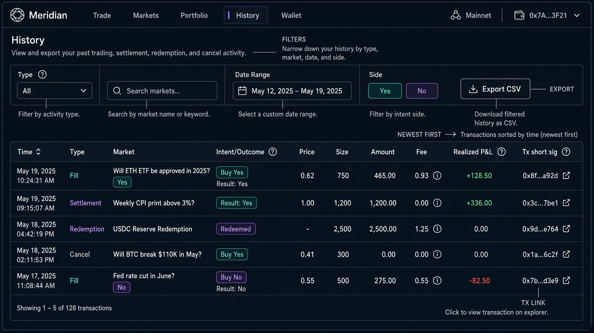

# Wireframe — History (`/history`)

Source spec: [`docs/ui/05-history.md`](../05-history.md)

## Zones
| Zone | Must include |
| --- | --- |
| Filters | Type · market search · date range · Side Yes/No · Export CSV |
| Table | Time, Type, Market, **Intent/Outcome** (Buy/Sell Yes/No — not raw bid/ask), Price, Size, Amount, Fee, Realized P&L, Tx |
| Tx | Short sig + explorer link |

## Approval checklist
- [ ] Fills labeled as one of four intents
- [ ] Settlements show result + context
- [ ] Export CSV present
- [ ] Sample markets should be MAG7 equity binaries in production copy (image may show generic questions — ignore)
