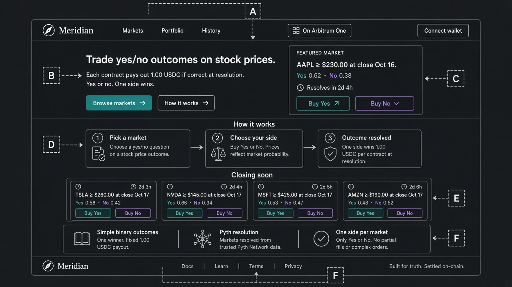

# Wireframe — Landing (`/`)

Source spec: [`docs/ui/01-landing.md`](../01-landing.md)

## Zones (approve these)
| Label | Zone | Must include |
| --- | --- | --- |
| A | Header | Logo, Markets, Portfolio, History, Solana cluster badge, Connect wallet |
| B | Hero copy | Headline + 1.00 USDC payout subhead + Browse markets / How it works |
| C | Featured market | Question, Yes·No prices (sum ~1), countdown, Buy Yes / Buy No deep links |
| D | How it works | 3 steps: pick market → buy Yes/No → settle 1.00 / 0 |
| E | Closing soon | 4–6 cards sorted by `tradingCloseTs` |
| F | Rules + footer | One book · Pyth resolution · one side per market · risk note |

## Approval checklist
- [ ] Hero works without wallet
- [ ] Featured card shows both Yes and No (one market, not two rows)
- [ ] Payoff + risk copy present
- [ ] No sim controls
