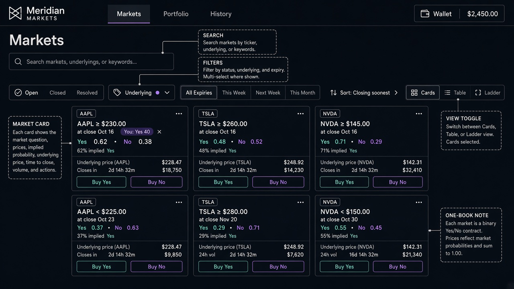

# Wireframe — Markets (`/markets`)

Source spec: [`docs/ui/02-markets.md`](../02-markets.md)

## Zones
| Zone | Must include |
| --- | --- |
| Search + filters | Status (Open default), Underlying, Expiry, Sort closing soonest |
| View toggle | Cards (default) · Table · Ladder |
| Market card | One card per market; Yes·No prices together; countdown; Buy Yes / Buy No; optional "You: Yes N" |
| Constraint | If user holds Yes, Buy No disabled with tooltip (per `06`) |

## Approval checklist
- [ ] Each market appears once (no separate Yes/No list entries)
- [ ] Ladder called out as third view (may not be fully drawn)
- [ ] Filters serializable to URL
