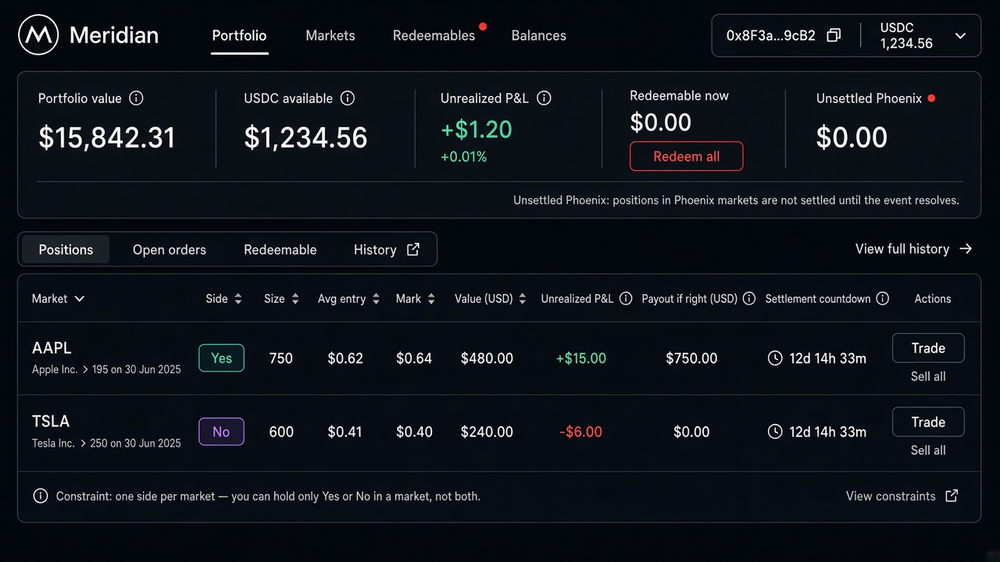

# Wireframe — Portfolio (`/portfolio`)

Source spec: [`docs/ui/04-portfolio.md`](../04-portfolio.md)

## Zones
| Zone | Must include |
| --- | --- |
| Summary | Portfolio value · USDC · Unrealized P&L · Redeemable (+ Redeem all) · Unsettled Phoenix |
| Tabs | Positions · Open orders · Redeemable · History link |
| Positions table | Market, Side chip, Size, Avg, Mark, Value, uPnL, Payout if right, countdown, Trade / Sell all |
| Constraint note | One side per market |

## Approval checklist
- [ ] One row per market (normally one side)
- [ ] Redeemables badge on nav / tab
- [ ] Disconnected state is connect prompt (not shown in happy-path image)
