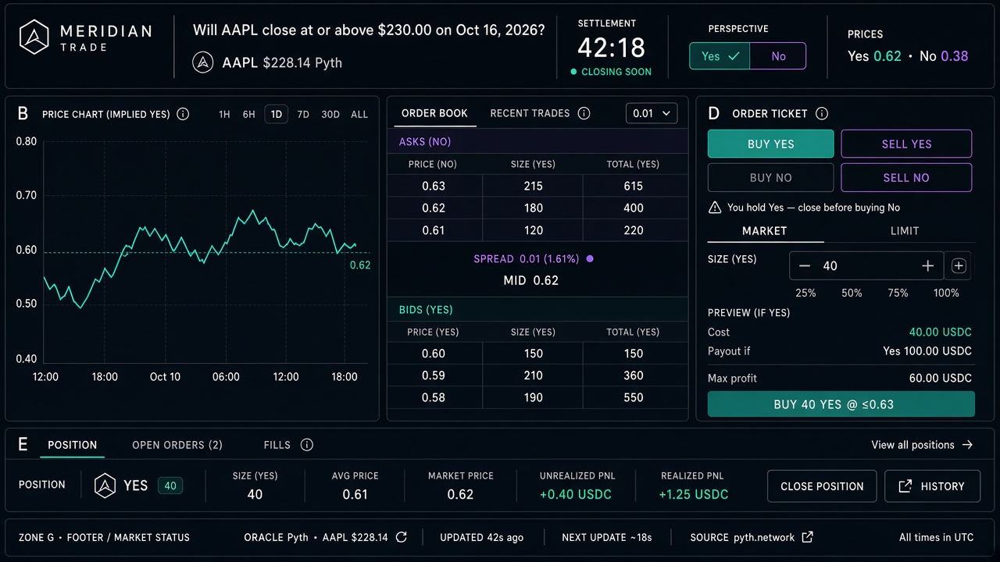

# Wireframe — Trade (`/markets/[marketId]`)

Source spec: [`docs/ui/03-trade.md`](../03-trade.md) · rules [`docs/ui/06-trading-intents-and-constraints.md`](../06-trading-intents-and-constraints.md)

## Zones
| Zone | Content |
| --- | --- |
| A | Question, Pyth underlying, **settlement countdown**, Yes\|No perspective toggle, both prices |
| B | Implied-price chart (perspective). *(Not shown since D-031; the order book sits at the top. The chart is planned work.)* |
| C | Order book + recent trades (No view = transform of Yes book) |
| D | Ticket: Buy/Sell × Yes/No intents, size, preview (cost, payout if right, max P/L), CTA |
| E/F | Position · Open orders · Fills; position summary + constraint UX |
| G | Rules / resolution (payoff one-liner, Pyth, timestamps) |

## Critical UX to approve
1. **One book, two perspectives** — toggle does not change subscriptions.
2. **Four intents** — never raw bid/ask.
3. **No Yes+No from UI** — sample shows Buy No disabled while holding Yes + "Sell N Yes" path.
4. **Countdown** primary in header; trading disables near close per `06`.
5. Side colors teal/violet — not red/green for Yes/No. *(Superseded by D-028: Yes = green, No = red, bid = green, ask = red.)*

## Approval checklist
- [ ] Layout density OK for Engineers (chart | book | ticket)
- [ ] Constraint copy + recovery action clear
- [ ] Payoff preview uses "Payout if right" / 1.00 USDC language
